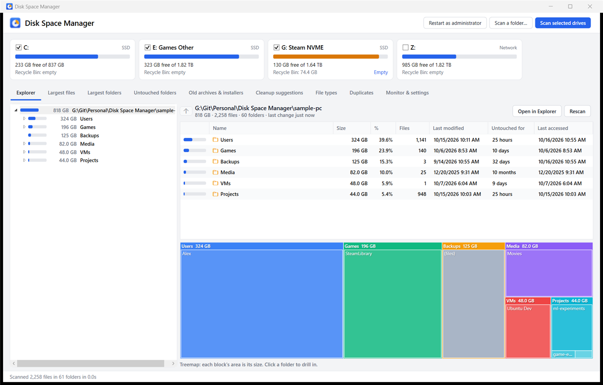
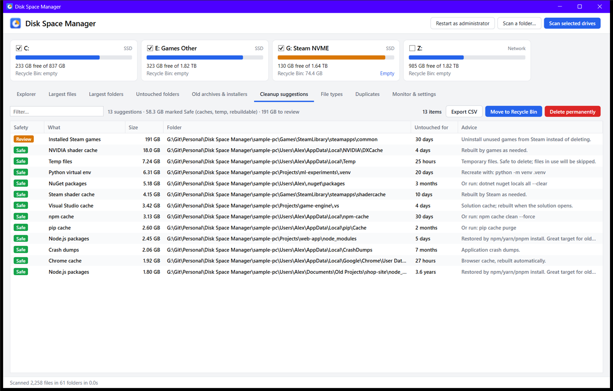
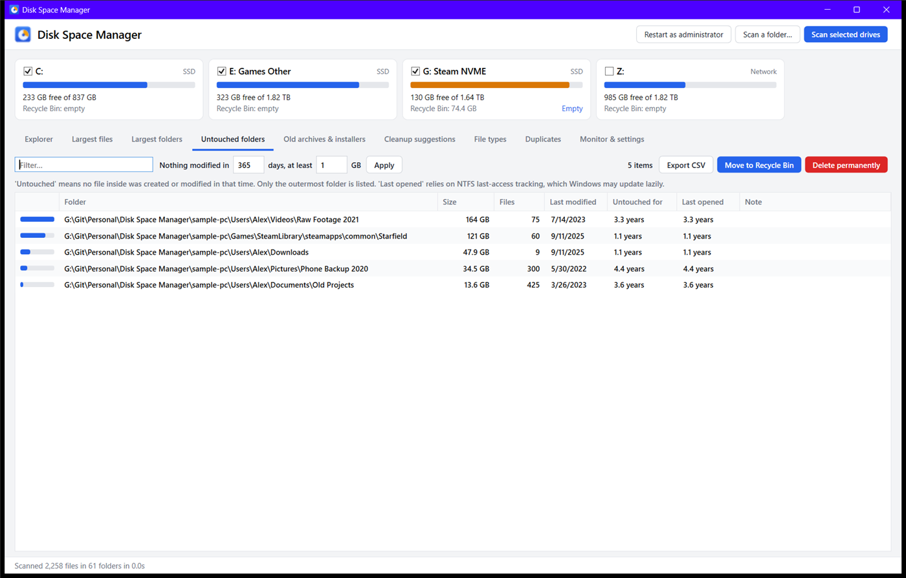
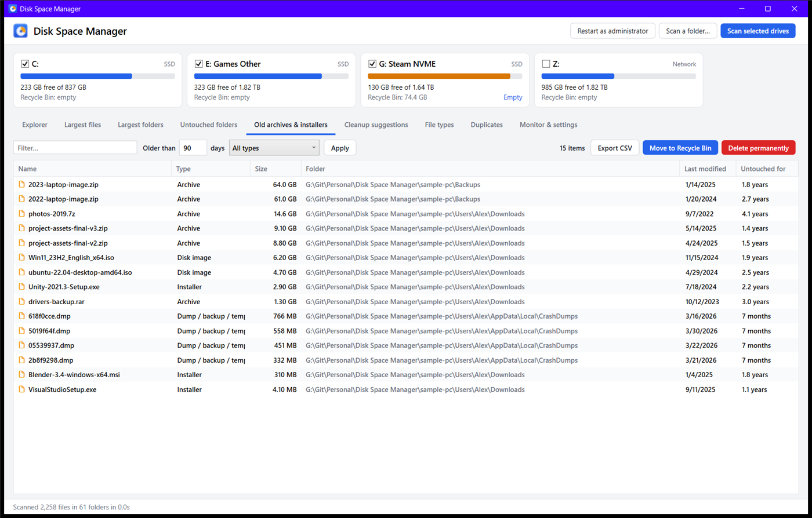
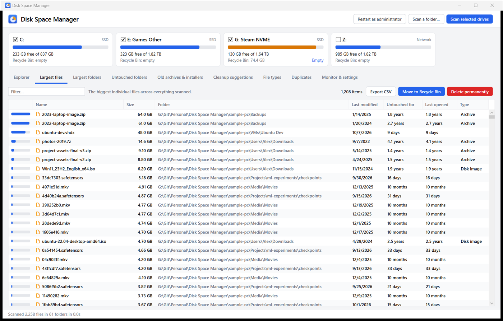
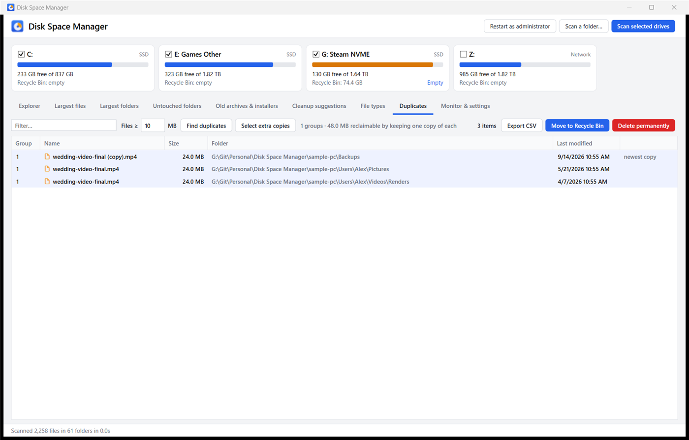
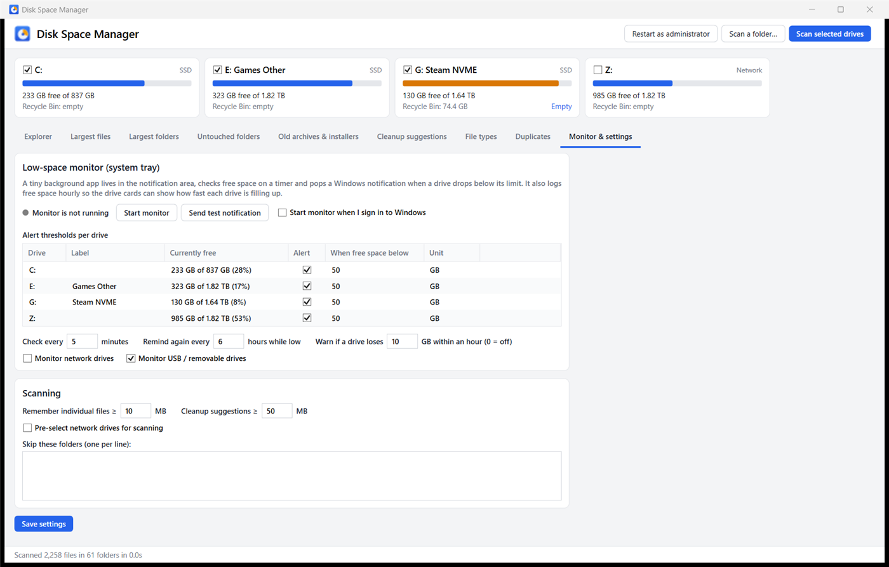

# Disk Space Manager

Find out what's eating your disk space on **every drive at once**, delete it safely, and get a Windows notification before a drive fills up.



## Download

| Download | Use it when |
|---|---|
| **[DiskSpaceManager-win-x64.zip](https://github.com/Brandin-Canterbury/disk-space-manager/releases/latest/download/DiskSpaceManager-win-x64.zip)** (small) | You already have the [.NET 8 Desktop Runtime](https://dotnet.microsoft.com/download/dotnet/8.0) installed. |
| **[DiskSpaceManager-win-x64-standalone.zip](https://github.com/Brandin-Canterbury/disk-space-manager/releases/latest/download/DiskSpaceManager-win-x64-standalone.zip)** | You're not sure. It runs on any 64-bit Windows 10/11 with nothing else to install. |

All versions are on the [Releases page](https://github.com/Brandin-Canterbury/disk-space-manager/releases). A new release is built automatically on every push to `main`.

## Quick start

1. Unzip anywhere, e.g. `C:\Tools\DiskSpaceManager`. Keep both `.exe` files in the same folder.
2. Run **DiskSpaceManager.exe**.
   The exe isn't code-signed, so Windows SmartScreen may warn you the first time. Click **More info**, then **Run anyway**.
3. Tick the drives you want on the cards at the top, then click **Scan selected drives**. A few terabytes takes about a minute on an SSD.
4. Browse the tabs. Select items and press **Del** to send them to the Recycle Bin, or **Shift+Del** to delete them permanently.
5. Open **Monitor & settings**, click **Start monitor**, and tick **Start monitor when I sign in to Windows** to get low-space alerts.

Optional: click **Restart as administrator** to include folders your account can't normally read, such as other users and parts of Windows.

## What it shows

### Cleanup suggestions
Known space hogs (caches, temp folders, package caches, `node_modules`, shader caches, Windows Update leftovers, Steam, AI model caches and more) are found automatically and rated **Safe**, **Review** or **Caution**, with advice for each.



### Untouched folders
Big folders where nothing has changed in a year or more (you can set the age and size). Good for spotting that 200 GB folder you forgot about.



### Old archives & installers
Old `.zip`, `.rar`, `.7z` and `.iso` files, `.msi` packages, setup `.exe` files in Downloads, crash dumps, and `.bak`/`.old`/`.tmp` files, filtered by age.



### Largest files, largest folders, file types



### Duplicates
Finds identical files by comparing size, then a quick fingerprint, then a full SHA-256 hash. Hard links are ignored because deleting one frees nothing. **Select extra copies** selects everything except the newest copy in each group.



### Drive cards
Each card shows free space and the size of that drive's Recycle Bin, with a one-click **Empty**. When the monitor is running, it also shows how much space the drive used in the last 24 hours, 7 days and 30 days.

## Low-space monitor (system tray)

`DiskSpaceMonitor.exe` is a tiny tray app that uses about 12 MB of RAM.

- It checks free space every few minutes and shows a **Windows notification** when a drive drops below its limit. The default is 50 GB; you can set a limit in GB or % for each drive. It reminds you every few hours while a drive stays low.
- It also warns you if a drive suddenly loses a lot of space, 10 GB within an hour by default.
- The tray icon shows how full your fullest drive is and turns red when a drive is low. Right-click it for each drive's free space; double-click it to open the analyzer.
- It logs free space every hour, which is where the drive-card trends come from.



It runs as a tray app rather than a Windows Service because services can't show notifications or tray icons. Starting at sign-in is the standard Windows way to do this.

## Safety

- Deleting goes to the **Recycle Bin** by default. If something is too big for the Recycle Bin, Windows asks before deleting it permanently.
- Windows, drive roots, user profiles, `pagefile.sys`, `hiberfil.sys`, restore points and the Recycle Bin folders themselves **can't be deleted** from the app.
- Program Files, ProgramData and AppData show a warning first. It's usually better to uninstall the app properly.

## Command line

```bash
DiskSpaceManager.exe --scan "D:\Some Folder"
```

```bash
DiskSpaceManager.exe --settings
```

`--scan` opens a new window and scans that folder right away. `--settings` opens straight to the Monitor & settings tab.

Settings are stored in `%APPDATA%\DiskSpaceManager\settings.json`, which both apps share.

## Building from source

You need the [.NET 8 SDK](https://dotnet.microsoft.com/download/dotnet/8.0).

```bash
dotnet build DiskSpaceManager.slnx
```

Both exes end up in `artifacts\bin\Debug\`. To build a release copy into `.\publish`:

```bash
powershell -ExecutionPolicy Bypass -File publish.ps1
```

To recreate the demo data used in the screenshots (about 800 GB of sparse files that use almost no real disk space):

```bash
powershell -ExecutionPolicy Bypass -File tools\make-sample-data.ps1
```

| Project | What it is |
|---|---|
| `src/DiskSpaceManager.Core` | Scanner, analysis rules, safety guard, settings, shell integration |
| `src/DiskSpaceManager.App` | WPF analyzer (`DiskSpaceManager.exe`) |
| `src/DiskSpaceManager.Monitor` | WinForms tray monitor (`DiskSpaceMonitor.exe`) |

## Releases

[`.github/workflows/release.yml`](.github/workflows/release.yml) runs on every push to `main` that changes code. It builds both apps, versions them `1.0.<build number>`, and publishes a GitHub Release with both zips. The download links at the top always point to the newest release. Pull requests get a test build only. Changes to docs alone don't trigger a release.
